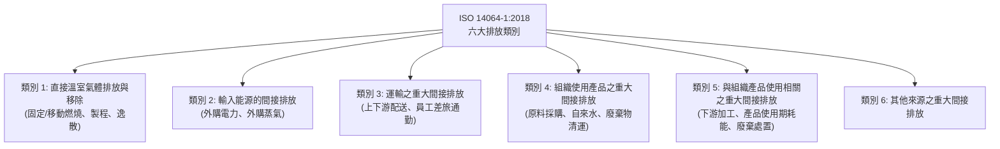

# ISO 14064-1 組織層級溫室氣體盤查標準

> [!NOTE] 白話費曼比喻
> **ISO 14064-1** 就是企業的「碳會計審計準則」。
> 如果一間公司要告訴全世界「我們今年排了多少碳」，不能自己隨便拿計算機加一加，必須按照這本國際規矩，把廠房內外的所有排碳活動一五一十寫進「碳清冊」，才能通過第三方檢驗。

---

## 一、標準定位與演進

* **定義**：由國際標準化組織（ISO）發布，規範組織（企業、機關、學校）層級如何設計、發展、管理及報告溫室氣體排放量與移除量的國際標準。
* **版本演變**：
  * **2006 初版**：採「三大範疇（Scopes）」，僅強制範疇一與二，範疇三列為自願盤查。
  * **2018 第二版（現行版本）**：廢除範疇字眼，改為 **六大類別（Categories）**，並引入 **[[重大間接排放判定準則]]**，使組織必須將重大供應鏈排放強制納入量化。

---

## 二、ISO 14064-1:2018 六大排放類別

---

## 三、五大資料治理原則

1. **相關性 (Relevance)**：符合預期使用者（政府、投資人、客戶）之決策需求。
2. **完整性 (Completeness)**：不隱匿、不蓄意排除任何已知排放源。
3. **一致性 (Consistency)**：歷史與跨年度數據可公平比對。
4. **準確性 (Accuracy)**：降低誤差與不確定性，確保數據真實性。
5. **透明度 (Transparency)**：所有數據來源、係數與假設清楚附註。

---

## 四、關聯概念與筆記
* 課堂進度：[[02_ISO14064-1概論與標準架構]]、[[03_ISO14064-1實務操作與盤查量化]]
* 相關標準：[[ISO 14064-2]]（減量專案）、[[ISO 14067]]（產品碳足跡）、[[ISO 14064-3]]（查證規範）
* 核心方法：[[組織邊界與報告邊界]]、[[重大間接排放判定準則]]、[[數據品質與不確定性分析]]
