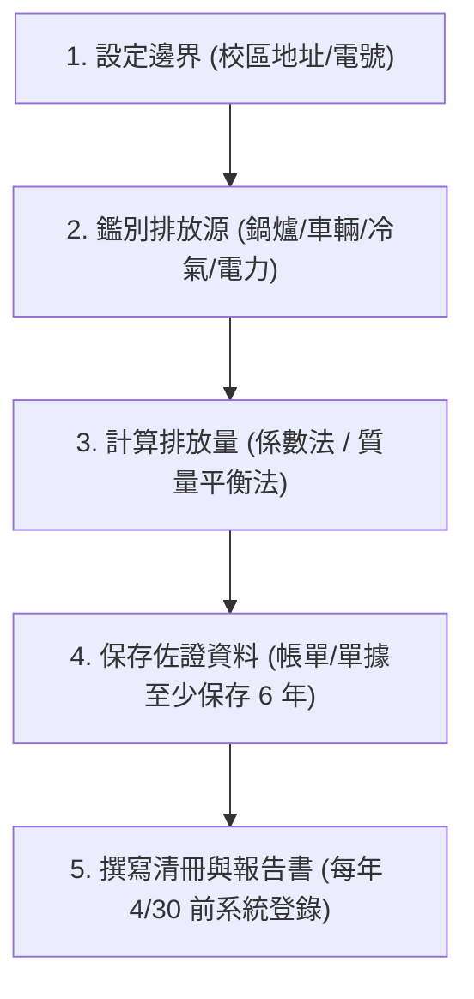

# 01. 大專校院溫室氣體盤查作業實務指引

> [!NOTE] 白話比喻
> 碳盤查就像學校每年的「健康檢查」。想要減肥（減碳），不能只憑感覺，必須先站上體重計量出準確的體重（碳排放量），並找出最肥胖的部位（排放熱點，如外購電力、冷媒逸散），才能對症下藥開出減肥處方籤。

---

## 📌 本單元精華一句話
環境部將大專校院納入溫室氣體盤查列管對象，自 115 年起，符合用電門檻之學校必須於每年 4 月 30 日前完成「範疇一（直接排放）」與「範疇二（能源間接排放）」的盤查登錄，且現階段**免經第三方機構查驗**。

---

## 一、 背景與法規架構 (Context)

1. **法源依據**：
   - 依據《氣候變遷因應法》（簡稱氣候法）第 21 條第 1 項，環境部於 114 年 3 月 4 日公告「事業應盤查登錄溫室氣體排放量之排放源」，正式將**大專校院**、大型服務業、醫療機構等納入盤查體系。
2. **分級管理原則（重點對比）**：
   - 工廠與傳統高耗能製造業（如鋼鐵、水泥、半導體）：須於 **4/30 前登錄**，並於 **10/31 前完成第三方查驗機構查驗**。
   - **大專校院**：採分級管理精神，**僅需完成盤查與登錄，無須經查驗機構查驗**，降低校方行政負擔。

> [!TIP] 考試與實務重點：納管門檻
> 大專校院符合下列**任一條件**即被納管：
> 1. **全校各校區年外購電力合計達 2,000 萬度（kWh）以上**（由校本部統一申報）。
> 2. **單一校區年外購電力達 1,000 萬度（kWh）以上**（若全校未達兩千萬度，則由達標的單一校區獨立申報）。

---

## 二、 盤查範圍與邊界 (Boundary & Scope)

### 1. 盤查邊界設定
- **邊界認定**：以教育部賦予之「學校代碼」所登載之地址為準。若有分校區，需一併列出地址與電號。
- **排除邊界（避免重複計算）**：
  - 若校園內設有具獨立商工登記之事業（如便利商店、連鎖咖啡廳），**應明確劃分並予以排除**。
  - 學校附設醫院若有獨立醫事機構代碼，由醫院各自依規定辦理。

### 2. 涵蓋的 [[溫室氣體範疇]]
- **[[溫室氣體範疇|範疇一：直接排放 (Scope 1)]]**：學校自己燃燒或逸散出來的氣體。
  - 固定燃燒：發電機柴油、廚房瓦斯爐（天然氣/桶裝瓦斯）、熱水鍋爐。
  - 移動燃燒：學校自有公務車、接駁校車之汽柴油（*不含租賃車與師生私家車*）。
  - [[逸散排放]]：冷氣冷媒、飲水機冷媒、化糞池、滅火器。
- **[[溫室氣體範疇|範疇二：能源間接排放 (Scope 2)]]**：學校外購使用的電力（通常佔全校總排放量 90% 以上）。
- **範疇三：其他間接排放 (Scope 3)**：師生通勤、採購原物料等，環境部**未列入法規強制盤查**（金管會永續報告書方要求）。

---

## 三、 盤查作業五大步驟

---

## 四、 核心計算方法與實務範例

盤查計算的核心採用 [[排放係數法]] 與 [[全球暖化潛勢_GWP]]（依環境部規定採 **IPCC AR5** 百年尺度版本）。

### 1. 固定與移動燃燒（發電機、瓦斯、公務車）
$$\text{年排放量} = \text{活動數據} \times \text{低位熱值} \times 4.1868 \times 10^{-9} \text{ (TJ/kcal)} \times \text{排放係數} \times \text{GWP}$$

> [!NOTE] 為什麼要換算熱值？
> 每一種燃料的能量密度不同（一公升柴油和一立方公尺天然氣釋放的能量不同）。透過乘以「低位熱值」轉成熱量單位（TJ），再乘上每單位熱量的排碳係數，計算才會精準。

### 2. 外購電力計算（範疇二核心）
$$\text{排放量 (公噸 } \mathrm{CO_2e}) = \text{外購用電度數 (千度)} \times \text{經濟部公告電力排碳係數 (公斤 } \mathrm{CO_2e/度)}$$
- 若學校自設太陽能自發自用，發電不產生直接排放，排放係數以 $0$ 計算。

### 3. [[逸散排放]] 的兩大易錯考點

> [!WARNING] 常見盲區一：化糞池要不要算？
> - 若校園污水**已納入公共污水下水道系統**（水費單上有列污水下水道使用費），**化糞池排放量為 0，無須計算**！
> - 若未納入公共下水道，才需依全校教職員生人數與上課天數推估甲烷逸散量。

> [!WARNING] 常見盲區二：滅火器哪種需要算？
> - **ABC 乾粉滅火器**（主要成分為磷酸二氫銨 $\mathrm{NH_4H_2PO_4}$）：反應不產生 $\mathrm{CO_2}$，**不列入盤查**。
> - **BC 乾粉 / $\mathrm{CO_2}$ / 潔淨滅火器 (HFCs)**：需依藥劑成分列入計算！

---

## 五、 課堂複習思考題

1. **問**：若全校年用電量為 1,800 萬度，台北校區 1,200 萬度、新竹校區 600 萬度，請問誰該申報？
   - **答**：全校合計未達 2,000 萬度，但台北校區單一場所達 1,000 萬度以上，因此由**台北校區**單獨進行盤查申報。
2. **問**：教授自費開自己的車去外校開會，加油發票報帳，要不要算入學校範疇一？
   - **答**：**不用**。私人車輛與租賃車輛屬於範疇三，學校範疇一僅計算「學校自有車輛（行照登載為學校名稱）」。
