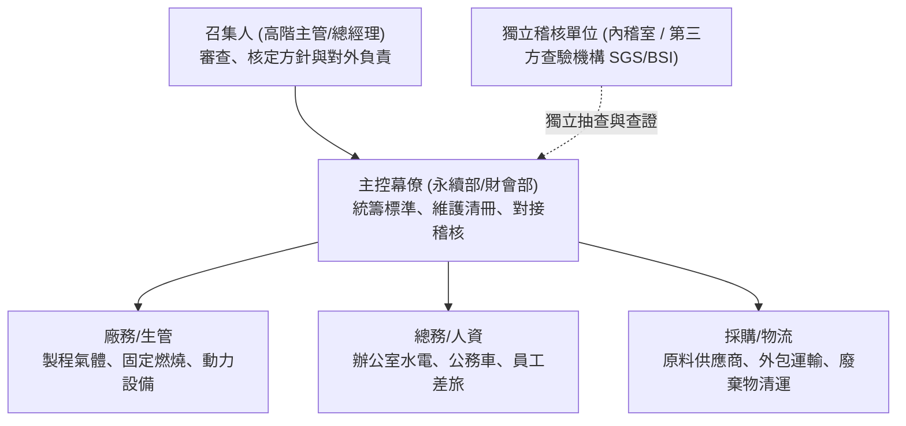
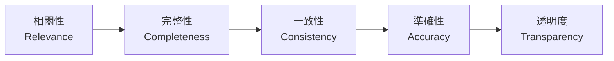

# ISO 14064-1:2018 概論與標準架構

> [!NOTE] 白話費曼比喻
> 如果說企業做財務報表有一套嚴謹的「會計準則」（IFRS），那麼 **[[ISO 14064-1]]** 就是全世界公認的「碳會計準則」！
> 它可以幫助企業把廠區與上下游所有看不見的排碳活動，清清楚楚折算成「碳帳本」，確保每一筆碳排都有發票、有憑證、可查核。

---

## 本堂大綱與一句話總結

* **一句話總結**：ISO 14064-1:2018 是組織型溫室氣體盤查的最高國際規範，以五大原則為核心心法，將組織排放劃分為六大類別，並藉由嚴謹的內部治理與重大性評估，建立具備公信力的碳帳本。
* **核心章節**：
  1. 溫室氣體管理與內部治理架構（RACI 權責與三道防線）
  2. ISO 14064 系列家族與版本演進（2006 版 vs 2018 版）
  3. 盤查五大核心原則（相關性、完整性、一致性、準確性、透明度）
  4. ISO 14064-1:2018 十大標準章節核心條文解析
  5. 基準年設定與報告書 18 項法定必要內容

---

## 一、溫室氣體管理與內部治理架構

碳盤查不是單一窗口或環安衛工程師的個人作業，而是一項跨部門的**數據治理工程**。

### 1. 跨部門 RACI 權責分工
* **執行者 (Responsible)**：實際動手收集原始單據（電費單、加油發票、磅單）並登錄系統的現場人員（如廠務、總務、會計）。
* **負責者 (Accountable)**：對最終碳清冊結果負成敗責任並對外簽字核准的高階主管（永續長、財務長、總經理）。
* **顧問 (Consulted)**：遇到係數選用爭議或邊界模糊時提供專業意見的外部顧問。
* **被通知者 (Informed)**：報告產出後接收查核結果的利害關係人（董事會、投資人、業務部門）。

### 2. 數據治理的「三道防線」
1. **第一線現場數據源頭**：廠務、生管、採購、總務，嚴格落實原始憑證歸檔。
2. **專責管理幕僚**：永續發展部／財會部，管控清冊、維護係數庫並執行異常值警告。
3. **獨立確信與稽核**：內部稽核室進行定期抽查，並由外部第三方查驗機構（如 SGS、BSI）執行查證。

> [!TIP] 考試重點：內部控制點防呆機制
> 碳盤查最容易出錯的環節是**「單位換算」**與**「跨期異常」**：
> 1. **單據輸入檢核**：系統需設定防呆機制，避免公升與公斤、度（kWh）與千度混淆。
> 2. **異常值警告**：比對同產能歷史同期的能耗數據，若出現異常暴增或暴跌，系統強制要求填寫原因說明。

---

## 二、ISO 14064 系列標準關係與改版差異

### 1. ISO 14064 家族三大構面

| 標準代號 | 性質與層級 | 核心目標 | 產出文件 |
| :--- | :--- | :--- | :--- |
| **[[ISO 14064-1]]** | **組織面**（企業/機構） | 設計與發展組織溫室氣體盤查清冊 | 溫室氣體盤查報告書、碳清冊 |
| **[[ISO 14064-2]]** | **技術專案面**（減量案） | 量化、監督與報告專案的減量或增強移除 | 溫室氣體減量計畫書、監測報告 |
| **[[ISO 14067]]** | **產品面**（單一商品/服務） | 計算產品從搖籃到大門或搖籃到墳墓的碳足跡 | 產品碳足跡研究報告（CFP Report） |
| **[[ISO 14064-3]]** | **查證與確證準則** | 提供查證機構對聲明進行確證與查證的指引 | 獨立查證聲明書（Opinion） |

### 2. 2006 舊版 vs 2018 新版的根本變革

> [!WARNING] 易混淆點：為何要廢除「範疇 (Scopes)」字眼？
> 在 2006 舊版標準中，範疇一（直接排放）與範疇二（能源間接）是強制盤查，而範疇三（其他間接）被列為「自願盤查」。這導致過去十幾年企業習慣性「鴕鳥心態」，只盤查自家廠房，對佔比高達 70%~90% 的供應鏈間接碳排視而不見。
> 
> **2018 新版改革重點**：
> 1. 廢除「範疇」字眼，重構為 **六大類別（Categories）**。
> 2. 引入 **[[重大間接排放判定準則]]**：類別三至類別六中，只要被評定為「重大間接排放」的項目，**一律強制量化並納入報告書**！

---

## 三、碳盤查五大核心原則（資料治理的基石）

依據 ISO 14064-1:2018 第 4 節規範，編制溫室氣體清冊必須遵循五大原則：

1. **相關性 (Relevance)**：
   * 選用符合「預期使用者」（政府主管機關、客戶、投資人）決策需求的邊界、數據與方法。主要體現在 [[組織邊界與報告邊界]] 的界定上。
2. **完整性 (Completeness)**：
   * 納入邊界內所有的溫室氣體排放與移除，不得刻意隱匿或蓄意排除隱形排放源（如化糞池、冷媒、緊急發電機）。
3. **一致性 (Consistency)**：
   * 確保碳排放數據在跨年度間能夠公平比較。基準年、計算方法、排放係數選用原則若有變更，必須清楚交代與追溯重算。
4. **準確性 (Accuracy)**：
   * 盡最大可能降低系統偏差與數據不確定性，計量儀器定期校驗，數據品質達到合理保證。
5. **透明度 (Transparency)**：
   * 充分揭露所有計算假設、活動數據來源、係數引用版本與文獻出處，讓查證員可以沿著稽核軌跡順暢追查。

---

## 四、ISO 14064-1:2018 條文結構與關鍵條款解構

| 章節編號 | 章節名稱 | 屬性 | 核心實務要求 |
| :--- | :--- | :--- | :--- |
| **第 1~3 節** | 適用範圍、引用標準、用語與定義 | 宣告性條款 | 界定七大溫室氣體、基準年、設施、組織等精準定義 |
| **第 4 節** | 原則 (Principles) | 精神與心法 | 相關性、完整性、一致性、準確性、透明度五大原則 |
| **第 5 節** | 溫室氣體盤查邊界 | **強制稽核核心** | 5.1 [[組織邊界與報告邊界|組織邊界]]（控制權法 vs 股權持分法） 5.2 報告邊界（六大類別鑑別與重大性篩選） |
| **第 6 節** | 排放與移除之量化 | **強制稽核核心** | 6.1 源與匯鑑別 6.2 量化方法（[[排放係數法]]、質量平衡法、直接監測法） 6.3 基準年設定與重新計算條件 |
| **第 7 節** | 減緩活動 | 管理要求 | 7.1~7.3 減量專案與目標。 **鐵律：減量額度不得直接從清冊排放量中扣除！** |
| **第 8 節** | 盤查品質管理 | 品質體系 | 8.1 資訊管理程序（SOP） 8.2 文件記錄至少保存 6 年 8.3 [[數據品質與不確定性分析]] |
| **第 9 節** | 溫室氣體報告 | 產出規格 | 9.3 必須包含 18 項法定必要核心內容（漏一項即開立缺失） |
| **第 10 節** | 組織在查證中之角色 | 查核應對 | 配合第三方查驗機構（如 SGS、BSI），提供佐證並矯正缺失 (NCR) |

---

## 五、報告書 18 項法定核心內容檢核表（第 9.3 節）

盤查報告書必須完整具備以下 18 項必要項目，否則查證時將被開立重大不符合項（NCR）：

1. 報告組織之描述與介紹
2. 負責人員或專責管理單位
3. 報告涵蓋期間（通常為日曆年 1/1 ~ 12/31）
4. 組織邊界（明訂控制權法或股權比例）
5. 報告邊界（包含間接排放重大性準則之界定）
6. 直接溫室氣體排放量（分氣體以公噸 $\text{CO}_2\text{e}$ 呈現）
7. 類別溫室氣體排放量（各別列出類別 1 至 6）
8. [[生質碳與自然碳匯|生物源二氧化碳排放量]]（**獨立表列，不得計入總排放量**）
9. 排除之溫室氣體源清單及其排除之合理說明
10. 基準年之選定與歷史盤查清冊
11. 基準年或其他歷史數據之重大變更與重算說明
12. 選用之量化方法說明與變更理由
13. 排放係數或移除係數之引用文件與資料來源
14. 選用之全球暖化潛勢值（[[全球暖化潛勢_GWP|GWP]]）版本（依環境部規定現行採用 **IPCC AR5**）
15. [[數據品質與不確定性分析|不確定性評估結果]]（定性評鑑或定量數值）
16. 溫室氣體聲明（Statement）
17. 查證類型與所達成之保證等級（合理保證或有限保證）
18. 組織所消耗輸入電力與產生輸出電力之量化排放

---

## 課堂重點回顧與課後思考

> [!TIP] 課堂金句
> * **「減量規減量，盤查歸盤查」**：購買綠電憑證（REC）若未實際轉供用電，不得直接抵扣外購電力碳排！
> * **「重算基準年不是想算就算」**：只有在組織併購、處分或方法論重大改變且超過顯著性門檻（通常為 5%）時，才能重算基準年。

### 課後思考題
1. 某半導體廠在 2024 年併購了一座位於台南的封裝廠，該廠排放量佔母公司總量 12%。依據 ISO 14064-1:2018，該公司是否需要重設基準年？為什麼？
2. 企業向總務部門索取電費單時，發現 112 年底最後一期帳單計費期間為「112/11/5 ~ 113/1/4」，跨越了年度交界，該如何正確計算 112 年度的用電度數？
*(解答：應按計費天數比例，將 113/1/1~1/4 的用電度數扣除，並補入前一年 111/11/5~112/1/4 跨入 112 年度的比例度數)*
