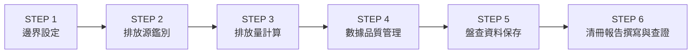

# ISO 14064-1 實務操作與盤查量化計算

> [!NOTE] 白話費曼比喻
> 如果把碳盤查比喻成「為整座工廠量體重」：
> * **邊界設定** 是決定哪些廠房、子公司要站上體重計；
> * **排放源鑑別** 是拿放大鏡找出身上哪裡藏著熱量（燃料、電表、冷媒管）；
> * **量化計算** 就是把每一包零食（活動數據）乘上營養標示（排放係數與 GWP）；
> * **數據品質管理** 則是校正這台體重計，證明量出來的數字不是隨便猜的！

---

## 本堂大綱與一句話總結

* **一句話總結**：遵循「邊、源、算、減、品、報、查」標準作業程序，深入六大類別盤查現場，熟練運用燃料熱值加權、化學計量質量平衡、冷媒逸散與數據誤差等級評定，完成合規之排放量清冊。
* **核心章節**：
  1. 盤查六大作業程序（STEP 1 ~ STEP 6）
  2. 組織邊界計算案例（控制權法 vs 股權持分法）
  3. 重大間接排放評估準則（A×B×C×D 矩陣打分）
  4. 類別 1 ~ 類別 6 現場鑑別與量化計算公式
  5. 數據品質管理與不確定性評估（$A_1 \times A_2 \times A_3$ 評級）
  6. 經典實務測驗與常見考點精析

---

## 一、盤查標準作業程序（六大步驟）

* **口訣記憶法**：**「邊 ➔ 源 ➔ 算 ➔ 減 ➔ 品 ➔ 報 ➔ 查」**
* 盤查包含兩大階段：
  1. **定性盤查**：邊界設定、排放源鑑別、重大性篩選。
  2. **定量盤查**：活動數據蒐集、排放係數套用、不確定性計算與清冊彙總。

---

## 二、邊界設定：組織邊界與報告邊界

### 1. 組織邊界整合案例（全球水泥公司）
某全球水泥公司旗下有三家轉投資公司，年排放量如下：
* **公司 A**（排放量 10,000 公噸 $\text{CO}_2\text{e}$）：具備 100% 股權、財務控制權與營運控制權。
* **公司 B**（排放量 5,000 公噸 $\text{CO}_2\text{e}$）：佔 50% 股權，由他公司營運，但全球水泥具備**財務控制權**（無營運控制權）。
* **公司 C**（排放量 1,000 公噸 $\text{CO}_2\text{e}$）：具備 100% 股權、財務控制權與營運控制權。

**三種彙總方法的計算結果比較**：
| 彙總方法 | 計算邏輯 | 全球水泥彙總排放量 |
| :--- | :--- | :--- |
| **股權比例法** | $10,000 \times 100\% + 5,000 \times 50\% + 1,000 \times 100\%$ | **13,500 公噸 $\text{CO}_2\text{e}$** |
| **財務控制權法** | $10,000 \times 100\% + 5,000 \times 100\% + 1,000 \times 100\%$ | **16,000 公噸 $\text{CO}_2\text{e}$** |
| **營運控制權法** | $10,000 \times 100\% + 5,000 \times 0\% + 1,000 \times 100\%$ | **11,000 公噸 $\text{CO}_2\text{e}$** |

> [!TIP] 考試重點：台灣法規邊界要求
> * **環境部管制作業**：以**管制編號**為單位，採**營運控制權法**申報全廠（場）排放量。
> * **金管會永續揭露要求**：盤查邊界必須與**財務報表範圍一致**（合併報表子公司），採**財務控制權法**。

---

## 三、重大間接排放判定準則（類別 3 ~ 6 篩選）

類別 3 到 6 不需要全部巨細靡遺計算，必須依據組織建立的判定準則進行篩選，評分達到顯著性門檻者方納入盤查：

### 四維度評分矩陣 (Score 1~3 分)

| 評分維度 | 3 分（高） | 2 分（中） | 1 分（低） |
| :--- | :--- | :--- | :--- |
| **A. 發生頻率** | 每週至少發生 1 次 | 每季至少發生 1 次 | 每年小於 3 次 |
| **B. 減碳機會** | 組織具完全控制權 | 須其他外部單位配合 | 完全沒減碳機會 |
| **C. 活動數據來源** | 會計／ERP 系統發票紀錄 | 採推估或抽樣估算 | 無法取得／取得極困難 |
| **D. 排放係數來源** | 國家公告／環境部係數 | 國際軟體係數（Simapro/Ecoinvent） | 無法取得公正係數 |

* **顯著性判定**：加總總分達門檻（如 10 分以上），或排放量佔比大於顯著性比例（如 1%），即判定為「重大間接排放」，必須強制納入清冊並量化。

---

## 四、各類別量化計算公式與實務範例

### 1. 類別一：固定燃燒源（燃料燃燒計算公式）

$$\text{排放量 } (\text{公噸 } \text{CO}_2\text{e}) = \sum_{i} \left[ \text{燃料使用量} \times \text{低位熱值} \times \text{單位轉換因子} \times \text{排放係數}_i \times \text{GWP}_i \right]$$

* **關鍵參數**：
  * 單位轉換因子：$1\text{ kcal} = 4.1868 \times 10^{-9}\text{ TJ}$
  * 燃料燃燒直接產生三種溫室氣體：$\text{CO}_2$、$\text{CH}_4$、$\text{N}_2\text{O}$，必須分別乘以各自的 [[全球暖化潛勢_GWP|GWP 值]]（AR5：$\text{CO}_2=1$, $\text{CH}_4=28$ 或 $30$, $\text{N}_2\text{O}=265$）後加總。
  * **加權平均熱值**：天然氣各月份熱值不同時，必須依各月用量進行加權平均，不可直接取算術平均！

### 2. 類別一：製程排放之質量平衡法（以乙炔焊接與脫硫石灰石為例）

* **乙炔燃燒化學反應式**：
  $$2\text{C}_2\text{H}_2 + 5\text{O}_2 \rightarrow 4\text{CO}_2 + 2\text{H}_2\text{O}$$
  * 分子量：$\text{C}_2\text{H}_2 = 26$，$\text{CO}_2 = 44$。
  * 碳含量比值：$\frac{44 \times 2}{26} \approx 3.3846\text{ kg } \text{CO}_2 / \text{kg } \text{C}_2\text{H}_2$。
  * 若購買 35 公斤乙炔完全燃燒：$35 \times 3.3846 = 118.46\text{ kg } \text{CO}_2$。

* **排煙脫硫石灰石反應**：
  $$\text{CaCO}_3 + \text{SO}_2 + 2\text{H}_2\text{O} \rightarrow \text{CaSO}_3 \cdot 2\text{H}_2\text{O} + \text{CO}_2$$
  * 每消耗 1 mole $\text{CaCO}_3$ (100) 產生 1 mole $\text{CO}_2$ (44)。
  * 排放係數為 $0.44\text{ ton } \text{CO}_2 / \text{ton } \text{CaCO}_3$。50 噸石灰石產生 $50 \times 0.44 = 22.00\text{ ton } \text{CO}_2$。

### 3. 類別一：人為逸散排放（冷媒、滅火器、化糞池）

* **冷媒設備**：
  * 方法一（優先）：該年度冷媒實際填充量。
  * 方法二（推估）：$\text{原始填充量} \times \text{設備逸散率 (\%)}$（如家用冷氣 5.5%、冰水機 8.5%、車用冷氣 15%）。
  * > [!WARNING] 考點注意
    > 舊冷媒 **R-22**、**R-12** 屬於蒙特婁議定書管制之破壞臭氧層物質（ODS），**不計入國家溫室氣體總量**（但須在報告書補充表列）；碳氫冷媒 **R-600a** GWP 極低（約 3），依規定未列入七大溫室氣體者免計。
* **滅火器**：
  * **ABC 一般乾粉滅火器**：主要成分為磷酸二氫銨，**不含七大溫室氣體，免盤查**！
  * **$\text{CO}_2$ 滅火器** 與 **FM-200 (HFC-227ea)**：機房常用，**必須盤查**。
* **化糞池（$\text{CH}_4$ 逸散）**：
  * **生活污水若有接管至污水下水道，由污水處理廠處理者，免計入類別一**（若委外處理則屬於類別四）。
  * 廠內未納管之化糞池：$\text{CH}_4 \text{ 逸散量} = \text{員工人數} \times 0.003825\text{ ton } \text{CH}_4/\text{人-年} \times \text{GWP}$。

### 4. 類別二：外購電力之最新規定（2025 雙軌係數）

經濟部自 2025 年起，將公用售電業電力排碳係數細分為兩類：
1. **產業盤查專用係數**：**0.466 kg $\text{CO}_2\text{e}$/度**（適用表燈營業、低壓、高壓、特高壓電力用戶）。
2. **民生住宅專用係數**：**0.471 kg $\text{CO}_2\text{e}$/度**（適用表燈非營業、包燈用戶）。

### 5. 類別三：運輸間接排放（延噸公里與延人公里）

* **貨物運輸**：$\text{活動數據 (延噸公里 tkm)} = \text{貨物重量 (噸)} \times \text{運輸距離 (km)}$。
* **人員差旅／通勤**：$\text{活動數據 (延人公里 pkm)} = \text{搭乘人次} \times \text{乘車距離 (km)}$。
  * 捷運服務碳足跡係數：$78.22\text{ g } \text{CO}_2\text{e}/\text{延人公里}$（可由捷運票價推估里程）。

---

## 五、數據品質管理與不確定性評估

在盤查不確定性無法全面定量時，採用「數據品質矩陣」進行評級：

### 單一排放源不確定性評分 ($A_1 \times A_2 \times A_3$)
$$\text{單一評分} = A_1 (\text{活動數據種類}) \times A_2 (\text{校驗可信度}) \times A_3 (\text{係數來源})$$

| 等級 | $A_1$ 活動數據種類 | $A_2$ 活動數據校驗 | $A_3$ 排放係數來源 |
| :---: | :--- | :--- | :--- |
| **1 分** | 連續自動量測（流量計/電表） | 每年外校 1 次以上（具有校驗佐證） | 自廠發展係數／質量平衡所得 |
| **2 分** | 間接量測或財會單據（電費單/磅單） | 內部校正或會計師查核簽證證明 | 製造商提供係數／區域性排放係數 |
| **3 分** | 推估或抽樣估計 | 未校驗／未定期記錄之估計值 | 國家公告係數／國際通用係數 |

* **清冊整體品質評分**：以各排放源排放量加權計算加權平均分數：
  * **第一級 (1 ~ 9 分)**：品質優良。
  * **第二級 (10 ~ 18 分)**：品質尚可，具持續改善空間（多數製造業常態）。
  * **第三級 (19 ~ 27 分)**：不確定性偏高，應優先建立儀器量測與校驗體系。

---

## 六、實務高頻考題解析（精選 10 題）

1. **割草機屬於固定燃燒源還是移動燃燒源？**
   * *解析*：乘坐式割草機屬於**移動燃燒源**；手推式或肩背式割草機屬於**固定燃燒源**（設備本體為小型小型動力工具，非載具）。
2. **哪種滅火器不需要納入碳盤查？**
   * *解析*：**ABC 乾粉滅火器**不需要（成分為磷酸鹽，不含 GHG）；$\text{CO}_2$ 滅火器與 FM-200 (HFC-227ea) 必須盤查。
3. **台灣事業申報碳盤查時，目前法定必須使用的 GWP 版本為何？**
   * *解析*：依據環境部 2024 年 3 月函示，一律採用 **IPCC AR5** 版本（如甲烷 GWP 為 28 或 30，氧化亞氮為 265）。
4. **如果上年度電力排碳係數尚未公告，該如何計算？**
   * *解析*：得以盤查當年度之「前一年度」（即 N-2 年）電力排碳係數計算並出具清冊；查驗完成前若公告新係數，亦無須重新製作。
5. **企業購買再生能源憑證（T-REC），在盤查時可以直接扣除排放量嗎？**
   * *解析*：**不行！** 若外購電力非屬轉供直供綠電，僅單純買憑證，仍須以公告電力排碳係數計算總排放量；憑證減碳成效必須在報告書減量章節（第 7 節）分開表列。
