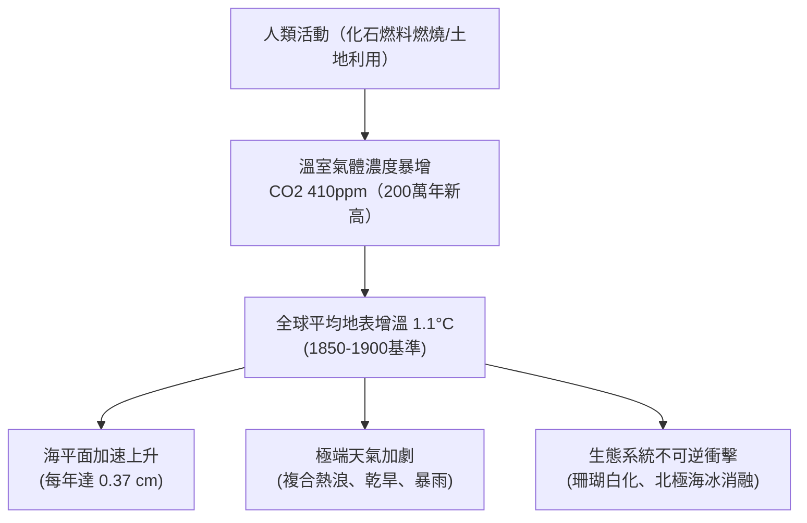
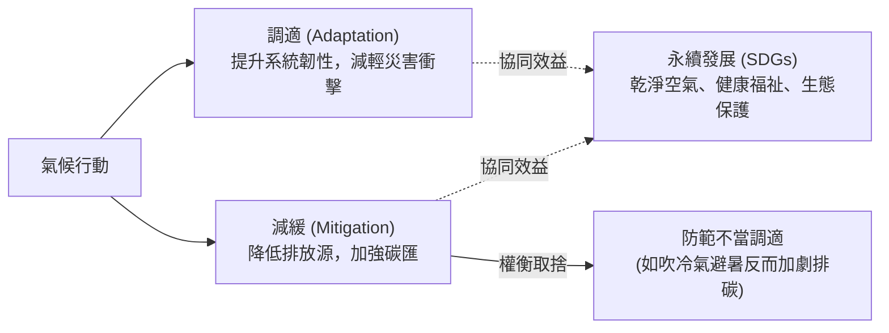

# 國際溫室氣體管制趨勢與 IPCC AR6 總結報告

> [!NOTE] 白話費曼比喻
> 如果把地球大氣層比喻成一間「密封的溫室玻璃屋」，過去一百多年人類不斷往裡面塞進暖爐（排放溫室氣體）。
> 現在玻璃屋裡面的溫度已經比過去高出 $1.1^\circ\text{C}$，熱浪、暴雨頻繁爆發。**IPCC AR6 報告** 就像是地球最頂尖的氣候醫生團隊開出的「體檢病危通知書」：如果不把全球剩餘的碳排額度（碳預算）嚴格踩煞車，十年之內就會衝破 $1.5^\circ\text{C}$ 的安全紅線！

---

## 本堂大綱與一句話總結

* **一句話總結**：IPCC 第六次評估報告總結報告（AR6 SYR）以無可辯駁的科學證據指出人類活動已造成全球升溫 $1.1^\circ\text{C}$，強調 2030 年前深度減排 43% 與調適行動的急迫性，並提出淨零路徑、需求端解方與公正轉型之宏觀藍圖。
* **核心章節**：
  1. IPCC AR6 總結報告架構與核心事實（當前升溫與排放差距）
  2. 未來氣候風險與關鍵門檻（$1.5^\circ\text{C}$ vs $2.0^\circ\text{C}$、氣候臨界點）
  3. [[碳預算與淨零途徑|碳預算]] 與「過衝 (Overshoot)」風險
  4. 近期減緩與調適行動：低成本解方與需求端轉型
  5. 氣候正義、制度政策與綠色金融（台灣 2050 淨零對接）

---

## 一、當前趨勢與狀態：科學事實與歷史責任

### 1. 關鍵科學數據
* **地表升溫**：2011~2020 年全球地表平均溫度較工業革命前（1850~1900 年）已高出 **$1.1^\circ\text{C}$**（陸地升溫幅度明顯高於海洋）。自 1970 年以來的升溫速度，比過去至少兩千年間任何時期都快。
* **溫室氣體濃度**：
  * $\text{CO}_2$ 濃度達到 **$410\text{ ppm}$**（至少 200 萬年來最高）。
  * $\text{CH}_4$（甲烷）與 $\text{N}_2\text{O}$（氧化亞氮）濃度為至少 80 萬年來最高。
* **排放來源結構**：
  * 全球約 **79%** 溫室氣體排放來自能源、工業、交通與建築部門。
  * **22%** 來自農業、林業與其他土地利用（AFOLU）。

### 2. 歷史貢獻與氣候脆弱度的極端不平等
* **排放極度不均**：全球 35% 人口生活在人均排放大於 $9\text{ 噸 }\text{CO}_2\text{e}$ 的國家；而 41% 人口生活在人均排放小於 $3\text{ 噸}$ 的國家。
* **台灣現況**：2016 年台灣人均碳排約 $11.73\text{ 噸}$，高居全球第 20 名，在亞洲僅略低於南韓。
* **脆弱社區的代價**：全球有 **33 ~ 36 億人**生活在高度氣候脆弱環境中。高度脆弱地區因洪旱、風暴導致的死亡率，是低脆弱地區的 **15 倍**！

---

## 二、未來氣候變遷與風險：$1.5^\circ\text{C}$ 與 $2.0^\circ\text{C}$ 的生與死

IPCC 評估指出，無論未來處於何種排放情境（即便是在極低排放的 SSP1-1.9 情境），全球在 2030 年前後均很有可能達到升溫 $1.5^\circ\text{C}$。

### $1.5^\circ\text{C}$ vs $2.0^\circ\text{C}$ 衝擊對比表

| 氣候影響領域 | 升溫 $1.5^\circ\text{C}$ | 升溫 $2.0^\circ\text{C}$ | 嚴重性對比 |
| :--- | :--- | :--- | :--- |
| **極端高溫** | 中緯度極端高溫增加 $3^\circ\text{C}$ | 中緯度極端高溫增加 $4^\circ\text{C}$ | 熱浪天數與頻率呈倍數成長 |
| **珊瑚礁存續** | **70% ~ 90%** 珊瑚礁消失 | **超過 99%** 幾乎滅絕 | 海洋生物多樣性遭受崩潰性破壞 |
| **北極夏季海冰** | 每 100 年出現一次無冰夏天 | 每 10 年至少出現一次無冰夏天 | 威脅洋流系統與全球氣候調節 |
| **水資源匱乏** | 全球約 **1 億人** 面臨缺水危機 | 全球約 **2 億人** 面臨缺水危機 | 缺水人口暴增一倍 |
| **海平面上升** | 本世紀末上升 0.26 ~ 0.77 公尺 | 上升幅度更大，且沿海大河三角洲鹽化 | 沿海都市與低窪島嶼面臨滅頂 |

> [!WARNING] 氣候臨界點 (Tipping Points) 與級聯風險
> 當全球升溫突破臨界門檻，可能觸發不可逆的巨變：
> 1. **大西洋經向翻轉環流 (AMOC) 崩潰**：造成全球天氣模式劇烈翻轉。
> 2. **極地冰蓋崩塌與永凍土融化**：釋放深鎖地底的大量甲烷，引發失控暖化反饋。

---

## 三、碳預算與淨零途徑：守住安全窗口

### 1. 剩餘碳預算 (Remaining Carbon Budget)
* **碳預算定義**：將全球暖化限制在特定升溫幅度（如 $1.5^\circ\text{C}$）內，大氣所能容納的歷史累積淨碳排放總量上限。
* 自 1850 年以來，人類已累計排放超過 **24,950 億噸 $\text{CO}_2$**。
* 要維持 50% 機率將升溫守在 $1.5^\circ\text{C}$，全球剩餘碳預算僅剩約 **3,800 ~ 5,000 億噸 $\text{CO}_2$**。以當前每年約 400 億噸的排放速率，**額度僅剩不到 10 年**！

### 2. 「過衝」(Overshoot) 現象的危險性
* **何謂過衝**：若未能在近期果斷減排，導致全球升溫短暫突破 $1.5^\circ\text{C}$（例如升至 $1.7^\circ\text{C}$），再期望於本世紀後半葉透過大量部署「負排放技術 / 碳移除 (CDR)」將氣溫降回 $1.5^\circ\text{C}$ 之內。
* **過衝代價**：過衝期間所造成的冰川融化、物種滅絕、珊瑚白化等損失是**不可逆**的，且大規模依賴生質能源結合碳捕捉（BECCS）或造林將引發嚴重的土地與糧食爭奪。

---

## 四、近期應對：低成本高潛力減緩與調適方案

### 1. 2030 關鍵減排時間表
* 要在 2050 年達成全球淨零並守住 $1.5^\circ\text{C}$，**全球在 2030 年的溫室氣體排放量必須較 2019 年減少 43%（$\text{CO}_2$ 減少 48%）**。
* 僅靠目前各國所承諾的「國家自主貢獻 (NDC)」，預估本世紀末全球將升溫達 **$2.8^\circ\text{C} \sim 3.2^\circ\text{C}$**，存在巨大的「減緩差距 (Mitigation Gap)」。

### 2. 高效益、低成本的減排技術
在 2010 ~ 2019 年十年間，關鍵綠色科技成本斷崖式下降：
* **太陽能發電 (Solar PV)**：成本下降 **85%**，裝機量增長逾 10 倍。
* **風力發電 (Wind)**：成本下降 **55%**。
* **鋰離子電池 (Lithium-ion Batteries)**：成本下降 **85%**，電動車銷量暴增逾 100 倍。
* **每噸減碳成本低於 20 美元** 的選項：太陽能、風能、能效提升、甲烷洩漏防制。

### 3. 需求端管理 (Demand-side Solutions)
* 透過改善生活方式與建築運作，需求端解方可在 2050 年為建築、交通與食品部門減少 **40% ~ 70%** 的溫室氣體排放：
  * **飲食轉型**：植物性飲食、減少食物浪費。
  * **綠色運具**：公共運輸、微移動（自行車）、車輛電氣化。
  * **能源服務精減**：建築節能保溫、智慧能源管理。

---

## 五、調適障礙、公正轉型與綠色金融

1. **調適極限**：
   * **軟限制 (Soft Limits)**：受限於資金不足、法規政策與技術限制，目前尚有解決空間。
   * **硬限制 (Hard Limits)**：自然生態已無法承受實質環境衝擊（如熱帶珊瑚礁與冰川），無法再透過人為工程適應。
2. **公正轉型 (Just Transition)**：
   * 減碳政策不能犧牲弱勢勞工與邊緣化社區的生計。例如煤礦工人的轉業培訓、高碳產業的轉型輔導。
3. **綠色金融 (Green Finance)**：
   * 全球有充足的民間資本，但缺乏流向氣候行動的明確機制。
   * 台灣推動「綠色金融行動方案 3.0」，透過氣候風險資訊揭露（TCFD）、碳排透明度引導金融業投融資支持產業去碳化。

---

## 課堂重點回顧與課後思考

> [!TIP] 考試與實務重點總結
> 1. **決定未來的十年**：2020~2030 是氣候行動最關鍵的黃金窗口，當前的基建投資若鎖定在高碳排資產，將造成無法挽回的「碳鎖定 (Carbon Lock-in)」。
> 2. **雙軌並進**：盤查與減排是「減緩」，建立防洪防旱耐災能力是「調適」，兩者不可偏廢。

### 課後反思題
* **題目**：請檢視台灣現行的氣候政策（《氣候變遷因應法》、2050 淨零排放路徑十二項關鍵戰略），是否與 IPCC AR6 的分析相符？有哪些符合之處？又有哪些需要強化的挑戰？
  * *提示方向*：
    1. **符合處**：確立 2050 淨零法律目標、大力發展風光綠能、推動運具電動化、實施碳費制度。
    2. **挑戰與強化處**：2030 中期目標（台灣目標為 24%±1%）與 IPCC 建議的 43% 仍有減碳差距；電網韌性、儲能配套與本土[[碳預算與淨零途徑|碳移除技術]]仍待加速落實。
